# Informe de Arquitectura de Backend Seguro

## 1. Portada

**Título del proyecto**
LaNonnaBackend

**Número y nombre del caso de negocio**
Pastas Frescas "La Nonna" — Sistema de ventas on-line con despacho a domicilio

**Integrantes**
Simón Saavedra (trabajo individual)

**Versión del frontend**
Frontend responsivo v2, en `frontend/web/`, derivado de los bocetos
`frontend/01-home.svg`, `02-catalogo.svg` y `03-carrito.svg`.

**Requisitos principales**
Arquitectura de microservicios privados en Node.js orientada a dominios de negocio
(`inventory`, `orders`, `clients`, `payments`), más `auth-service` y `analytics`.
API Gateway propio como única superficie pública, GraphQL Gateway privado para
agregaciones de lectura, canal gRPC interno para la reserva de stock, persistencia
relacional aislada —una base por microservicio— y administrador de secretos por
referencia simbólica. Control de versiones en GitHub.

**Brechas declaradas**

1. **Despliegue sin contenedores.** El sistema corre como nueve procesos Node
   coordinados por `npm start`. La separación entre red pública y privada se
   demuestra por *binding*: solo el API Gateway y el sitio estático escuchan fuera
   de loopback. El Módulo 10 admite explícitamente "otro entorno reproducible".
2. **Enunciado oficial del caso no provisto.** Los requisitos funcionales se
   derivaron por analogía con el caso de referencia del curso (`Caso19.docx`,
   Fukusuke Sushi-Delivery), conservando su numeración para facilitar la
   trazabilidad. Se marcan como supuestos en la sección 1.1.
3. **Integraciones externas simuladas con adaptador de prueba.** El proveedor de
   pagos y el de correo no son accesibles desde este entorno. El adaptador
   conserva contrato, firma HMAC, clave de idempotencia y transiciones de estado;
   el servicio que las verifica (`payments`) es código real y está cubierto por
   pruebas.
4. **Pantallas incorporadas durante esta evaluación.** Los bocetos de la
   evaluación anterior cubrían tres pantallas. Las siete restantes (registro,
   acceso, checkout, mis pedidos, administración, despacho y reportes) se
   declararon como brecha y se implementaron en esta entrega, salvo las de
   back-office, que quedan cubiertas por API y pruebas pero sin pantalla propia.

### 1.1 Requisitos del caso

| ID | Requisito funcional |
|---|---|
| RF1 | Armar un pedido con los productos disponibles en el catálogo |
| RF2 | El pedido se prepara únicamente una vez confirmado el pago |
| RF3 | Permitir anular una compra, registrando el motivo |
| RF4 | Realizar la venta sobre pedidos de clientes, asociada a la caja de un cajero virtual |
| RF5 | Registro de clientes con RUN, nombre, dirección, comuna, provincia, región, fecha de nacimiento, sexo, correo y teléfono, validando la existencia del correo |
| RF6 | El registro puede hacerlo el cliente por la web o el administrador en el local |
| RF7 | Administrar la disponibilidad de cada producto |
| RF8 | Emitir boleta digital por cada venta y enviarla al correo del cliente |
| RF9 | Reporte de ventas por período para el dueño |
| RF10 | Mantenedores de productos, usuarios y clientes |
| RF11 | Validar el correo del cliente mediante una API de mensajería |
| RF12 | Autenticación de usuarios con acceso limitado según perfil |
| RF13 | Emitir las órdenes de despacho para cocina, en el orden de llegada |

**Regla propia del rubro, no presente en el caso de referencia.** La pasta fresca
es perecible. El sistema trabaja con producción y stock del día, con hora de corte
a las 16:00 para despacho en la jornada. Esta regla es la que justifica el
mecanismo de reserva de stock con vencimiento del Módulo 3.

**Desviación respecto del caso de referencia, decidida por el negocio.** El RF4
original exige vender solo a clientes registrados. Se implementó además la **compra
como invitado**: el visitante entrega únicamente un correo de contacto y puede
pagar sin crear cuenta. La decisión y sus consecuencias de seguridad están en el
Módulo 7.

---

## 2. Módulo 1: Servicios derivados del frontend

### Matriz de trazabilidad

| ID | Requisito (Subsistema) | Pantalla y Acción | Propósito | Verbo y Ruta | Entrada | Salida | Reglas y Errores | Clasificación | Acceso |
|---|---|---|---|---|---|---|---|---|---|
| S01 | RF1, RF7 (inventory) | **P02 Catálogo:** carga de productos | Listar lo que se puede comprar | `GET /api/v1/products` | `available`, `categoria`, `formato`, `q`, `page`, `limit` | 200 con lista paginada; `[]` si no hay resultados | 400 ante filtro inválido o `limit` fuera de 1..50. Solo campos del catálogo | Dato público | Anónimo |
| S02 | RF1 (inventory) | **P02:** abrir detalle | Ver un producto | `GET /api/v1/products/{id}` | — | 200 con el producto | 404 si no existe o está descontinuado | Dato público | Anónimo |
| S03 | RF1 (inventory) | **P01 Home:** categorías | Listar categorías | `GET /api/v1/categories` | — | 200 con lista | — | Dato público | Anónimo |
| S04 | RF1, RF7 (inventory) | **P01:** pastas del día | Vitrina del stock del día | `GET /api/v1/products/today` | — | 200 con 4 productos y `horaCorte` | El servidor decide qué es "del día", no la pantalla | Dato público | Anónimo |
| S05 | RF7, RF10 (inventory) | **P08 Admin:** crear producto | Alta de producto | `POST /api/v1/products` | `{nombre, categoria, formato, precio, porciones, stockDelDia}` | 201 con el producto | 400 si la categoría no existe | Dato público | Administrador |
| S06 | RF7, RF10 (inventory) | **P08:** editar | Modificar producto | `PUT /api/v1/products/{id}` | campos editables | 200 | 404 si no existe | Dato público | Administrador |
| S07 | RF7 (inventory) | **P08:** stock del día | Reponer producción | `PUT /api/v1/products/{id}/stock` | `{stockDelDia}` | 200 | 409 si el stock queda bajo lo ya reservado | Dato público | Administrador |
| S08 | RF10 (inventory) | **P08:** descontinuar | Retiro lógico | `DELETE /api/v1/products/{id}` | — | 200 | 409 si tiene reservas vigentes. **No borra**: marca descontinuado | Dato público | Administrador |
| S09 | RF5, RF6, RF11 (clients) | **P04 Registro:** crear cuenta | Alta de cliente | `POST /api/v1/clients` | RUN, nombre, correo, contraseña, teléfono, dirección, comuna, provincia, región, fecha de nacimiento | 201 con `{id, nombre, correo, estadoVerificacion}` | 409 si ya existe (mensaje único, no dice cuál). 422 si el dígito verificador no corresponde. 422 si es menor de edad | Datos personales (Restringido) + Credencial | Anónimo |
| S10 | RF11 (clients) | **P04:** confirmar correo | Verificar casilla | `POST /api/v1/clients/verify-email` | `{token}` | 200 | 400 si el token no sirve o ya se usó | Restringido | Anónimo con token |
| S11 | RF12 (auth) | **P05 Login:** entrar | Emitir sesión | `POST /api/v1/auth/login` | `{correo, password}` | 200 con `{accessToken, expiraEn, perfil}` | 401 **idéntico** para correo inexistente y clave incorrecta. 403 si el correo no está verificado. 429 tras 5 fallos en 15 min | Credencial | Anónimo |
| S12 | RF12 (auth) | header: salir | Revocar sesión | `POST /api/v1/auth/logout` | `{accessToken}` | 200 | Un token ya inválido no es error | Credencial | Autenticado |
| S13 | RF5 (clients) | **P06:** cargar mis datos | Ver perfil | `GET /api/v1/clients/me` | — | 200 con el perfil, **RUN enmascarado** | 404 si la cuenta no existe | Restringido | Propietario |
| S14 | RF5 (clients) | **P06:** actualizar | Cambiar dirección | `PUT /api/v1/clients/me` | `{direccion, comuna, telefono}` | 200 | RUN, correo y rol no se cambian por esta vía | Restringido | Propietario |
| S15 | RF10 (clients) | **P08:** listar clientes | Mantenedor | `GET /api/v1/clients` | — | 200 con hasta 100 | — | Restringido | Administrador |
| S16 | solución (orders) | **P03 Carrito:** validar comuna | Comprobar zona | `POST /api/v1/delivery/check` | `{comuna}` | 200 con `{dentroDelRadio, costo}` | Responde `false` con mensaje, no error | Dato público | Anónimo |
| S33 | solución (orders) | **P03:** poblar el selector | Listar comunas | `GET /api/v1/delivery/comunas` | — | 200 con 40 comunas y `radioKm` | — | Dato público | Anónimo |
| S17 | RF1 (orders) | **P03:** ver carrito | Mostrar carrito | `GET /api/v1/cart` | — | 200 con ítems y total **recalculado** | 503 si el catálogo no responde | Restringido | Cliente o invitado |
| S18 | RF1 (orders) | **P01/P02:** agregar | Sumar al carrito | `POST /api/v1/cart/items` | `{productoId, cantidad}` | 200 con el carrito | 404 si no existe, 409 sin stock, 400 si la cantidad sale de 1..20. **El precio no se recibe del navegador** | Restringido | Cliente o invitado |
| S19 | RF1 (orders) | **P03:** cambiar cantidad | Editar línea | `PUT /api/v1/cart/items/{id}` | `{cantidad}` | 200 | 404 si la línea no es suya | Restringido | Cliente o invitado |
| S20 | RF1 (orders) | **P03:** quitar | Eliminar línea | `DELETE /api/v1/cart/items/{id}` | — | 200 | 404 si la línea no es suya | Restringido | Cliente o invitado |
| S21 | RF1, RF4 (orders) | **P06:** confirmar pedido | Crear pedido | `POST /api/v1/orders` | `{direccionEntrega, comuna, observaciones?}` | 201 con `{pedidoId, estado, subtotal, descuento, total, ventanaDespacho, expiraReserva}` | 409 carrito vacío, sin stock o comuna fuera de radio. **El contenido y el total salen del servidor** | Restringido | Cliente o invitado |
| S22 | RF3 (orders) | **P07 Mis pedidos:** listar | Historial propio | `GET /api/v1/orders` | — | 200 con los pedidos del solicitante | Solo los propios | Restringido | Cliente o invitado |
| S23 | RF3 (orders) | **P07:** ver pedido | Detalle | `GET /api/v1/orders/{id}` | — | 200 | **404 si no le pertenece**, para no confirmar su existencia | Restringido | Propietario o personal |
| S24 | RF3 (orders) | **P07:** anular | Anular con motivo | `POST /api/v1/orders/{id}/cancellation` | `{motivo}` 10..300 | 200 con el registro | 409 si el estado ya no lo permite. **No borra el pedido** | Restringido | Propietario o administrador |
| S25 | RF2, RF4 (orders) | **P08:** cambiar estado | Avanzar el pedido | `PUT /api/v1/orders/{id}/status` | `{estado}` | 200 | 409 transición inválida. **403 si se intenta `pagado`** | Restringido | Administrador o cajero |
| S26 | RF13 (orders) | **P09 Despacho:** cola | Órdenes para cocina | `GET /api/v1/dispatch/orders` | — | 200 ordenado por llegada | Solo pagados y en preparación | Restringido | Despacho o administrador |
| S27 | RF2 (payments) | **P06:** ir a pagar | Iniciar cobro | `POST /api/v1/payments` | `{pedidoId, medio}` | 201 con `{pagoId, monto, urlRedireccion}` | 409 si el pedido no admite pago. **El monto lo fija `orders`** | Restringido / Secreto | Propietario |
| S28 | RF2 (payments) | — servidor a servidor | Aviso del proveedor | `POST /api/v1/payments/webhook` | cuerpo + `X-Signature` + `X-Idempotency-Key` | 200 procesada o ya procesada | 401 firma inválida, 409 monto distinto. **No se procesa dos veces** | Secreto de integración | Identidad del proveedor |
| S29 | RF2 (payments) | **P06:** estado del pago | Consultar pago | `GET /api/v1/payments/{id}` | — | 200 | 404 si no es suyo | Restringido | Propietario |
| S30 | RF8 (payments) | **P06:** ver boleta | Boleta digital | `GET /api/v1/invoices/{pedidoId}` | — | 200 | 404 si no es suya | Restringido | Propietario o personal |
| S31 | RF9 (analytics) | **P10 Reporte:** ventas | Totales por período | `GET /api/v1/reports/sales` | `from`, `to`, `agrupacion` | 200 con series y más vendidos | 400 rango inválido o mayor a un año. **Sin datos personales** | Agregado interno | Dueño o administrador |
| S32 | RF4 adaptado (auth) | **P03:** pagar como invitado | Sesión sin cuenta | `POST /api/v1/auth/invitado` | `{correo}` | 201 con token de 1 hora | 400 si el correo no tiene formato válido. **El identificador es aleatorio, no el correo** | Restringido | Anónimo |
| G01 | RF1, RF3 (graphql) | **P07:** resumen del pedido | Agregación de 3 subsistemas | `POST /graphql` → `resumenPedido` | `{id}` | Pedido + producto vigente + nombre del cliente | `null` si no le pertenece | Restringido | Propietario o personal |
| G02 | RF1, RF7 (graphql) | **P01:** toda la portada | Agregación de 2 subsistemas | `POST /graphql` → `portada` | — | Productos del día + categorías + mis últimos pedidos | Error parcial: si `inventory` cae, la lista va vacía | Mixto | Anónimo o autenticado |

**Reutilización.** P01 y P02 ejecutan la misma operación al agregar al carrito: es
un solo servicio (S18), no dos. S04 es un caso particular de S01, pero se expone
aparte porque la home no debe decidir qué significa "del día".

**Operaciones destructivas.** El único `DELETE` sobre un recurso de negocio es S08
y es un retiro lógico. La anulación de un pedido (S24) **no** es un `DELETE`: es un
`POST` que crea un registro de anulación, porque el RF3 exige conservar el motivo y
el RF9 necesita el histórico.

### Ejemplos de contratos JSON

**S18 — Agregar al carrito.** Entrada:

```json
{ "productoId": "prd_ravioles", "cantidad": 2, "precioUnitario": 1 }
```

Salida `200`. Nótese que el `precioUnitario` que mandó el navegador se ignoró:

```json
{
  "carritoId": "car_31ac",
  "items": [
    { "id": "it_01", "productoId": "prd_ravioles", "nombre": "Ravioles de ricotta",
      "formato": "500 g", "precioUnitario": 4990, "cantidad": 2, "subtotal": 9980,
      "disponible": true, "stockLibre": 10 }
  ],
  "subtotal": 9980, "despacho": 0, "total": 9980
}
```

**S21 — Confirmar pedido.** Entrada (no lleva ítems ni totales):

```json
{ "direccionEntrega": "Av. Pajaritos 1234", "comuna": "Maipu" }
```

Salida `201`:

```json
{
  "pedidoId": "ped_2026_0417",
  "estado": "pendiente_pago",
  "subtotal": 9980,
  "costoDespacho": 0,
  "descuento": 499,
  "total": 9481,
  "ventanaDespacho": "2026-11-09T18:00:00-03:00",
  "expiraReserva": "2026-11-09T12:20:00-03:00"
}
```

**S28 — Aviso del proveedor de pagos.** Entrada, con cabeceras
`X-Signature: <HMAC-SHA256 del cuerpo>` y `X-Idempotency-Key: <uuid>`:

```json
{
  "pagoId": "pag_55de",
  "pedidoId": "ped_2026_0417",
  "estado": "aprobado",
  "montoConfirmado": 9481,
  "referenciaExterna": "TRX-8f21a0c4"
}
```

Salida `200` la primera vez, y en una reentrega del mismo aviso:

```json
{ "estado": "ya_procesada", "resultado": "aprobado" }
```

**Respuesta real del catálogo a través del API Gateway**, sin token:

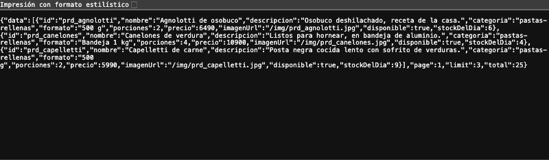

### Qué calcula el servidor y qué solo transporta el navegador

| Dato | ¿Lo envía el navegador? | ¿Quién lo determina? |
|---|---|---|
| Precio unitario | No | `inventory` |
| Subtotal, descuento y total | No, solo los muestra | `orders` |
| Costo de despacho | No | `orders`, según la comuna |
| Disponibilidad | No | `inventory` |
| Estado del pedido | No | `orders`, y solo tras aviso de `payments` |
| Estado del pago | No | `payments`, tras verificar la firma |
| Identidad del usuario | Envía el token | El gateway lo valida y propaga identidad verificada |
| Cantidad pedida | Sí | El servidor la valida contra stock y rango |
| Dirección de entrega | Sí | El servidor la valida contra el radio de despacho |

---

## 3. Módulo 2: Clases y cardinalidades del dominio

### Diagrama UML de dominio

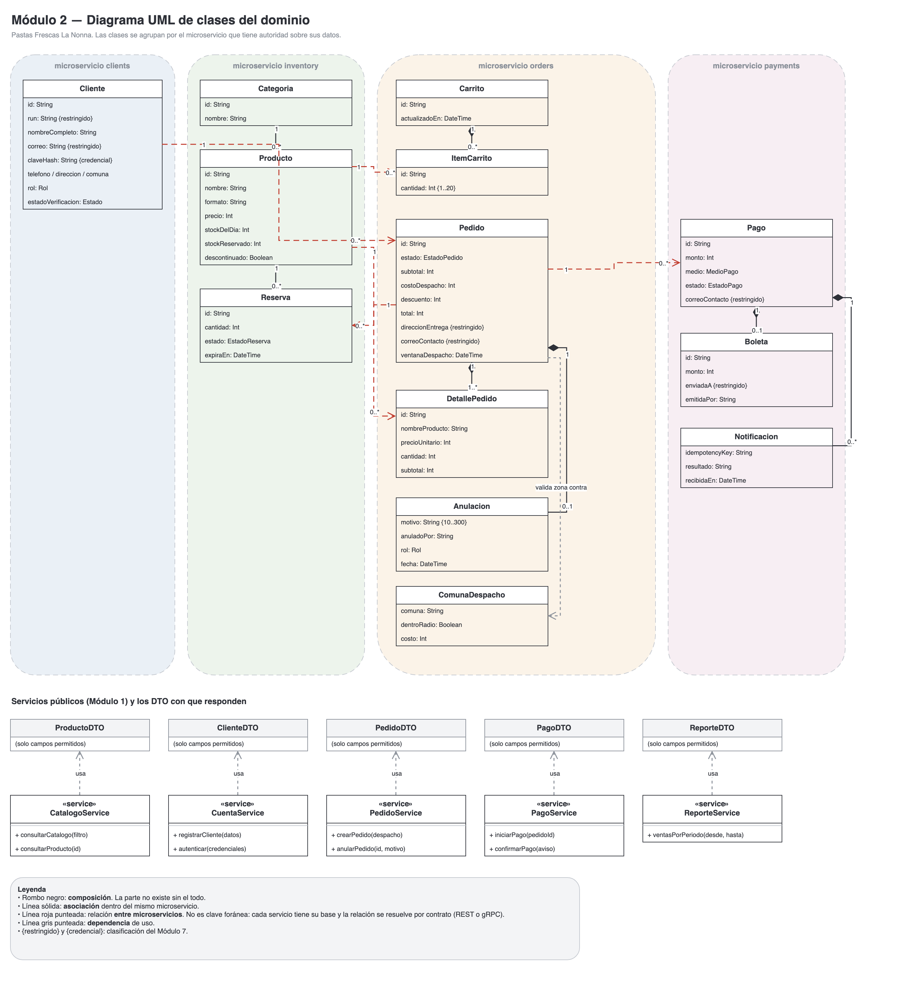

### Leyenda

- **Línea sólida con rombo negro (composición):** la parte no existe sin el todo.
  Si se elimina el pedido, desaparecen sus detalles.
- **Línea sólida simple (asociación):** relación entre entidades del mismo
  microservicio.
- **Línea roja punteada:** relación **entre microservicios**. No es una clave
  foránea: cada servicio tiene su propia base de datos y la relación se resuelve
  por contrato (REST o gRPC).
- **Línea gris punteada (dependencia):** el servicio usa el DTO para responder,
  sin exponer el modelo interno.
- `{restringido}` y `{credencial}`: clasificación del Módulo 7.

### Tabla de justificaciones

| Clase Origen | Mult. | Clase Destino | Mult. | Tipo de Relación | Justificación (Regla de Negocio) |
|---|---|---|---|---|---|
| Cliente | 1 | Pedido | 0..* | Asociación entre servicios | Un cliente recién registrado puede no haber comprado nunca (0) o tener historial (*). Cada pedido pertenece a un solo comprador. Como `clients` y `orders` son servicios distintos, `orders` guarda el identificador y pide los datos por contrato. |
| Cliente | 1 | Carrito | 0..1 | Composición | El carrito es del cliente y no sobrevive sin él. Es 0..1 porque se crea recién cuando agrega su primer producto. |
| Carrito | 1 | ItemCarrito | 0..* | Composición | Un carrito puede estar vacío. Al confirmar el pedido, los ítems se vacían: no se conservan como historial, porque ese papel lo cumple DetallePedido. |
| Pedido | 1 | DetallePedido | 1..* | Composición | **Un pedido confirmado contiene al menos un ítem.** Por eso 1..*, no 0..*: el servicio rechaza con 409 la confirmación de un carrito vacío. El borrador vacío es el Carrito, que es otra clase justamente por esto. |
| Pedido | 1 | Anulación | 0..1 | Composición | Un pedido se anula a lo sumo una vez, y la mayoría nunca. El registro guarda motivo, autor y fecha porque el RF3 lo exige. |
| Pedido | 1 | Reserva | 0..* | Asociación entre servicios | Un pedido reserva una línea de stock por producto. La reserva vive en `inventory`, que es la autoridad sobre el stock. |
| Pedido | 1 | Pago | 0..* | Asociación entre servicios | Es 0..* y no 0..1 porque un intento de pago puede fallar y el cliente reintentar. Solo uno puede quedar aprobado. |
| Pago | 1 | Boleta | 0..1 | Composición | La boleta se emite solo si el pago fue aprobado, y una sola vez por pedido (RF8). |
| Pago | 1 | Notificación | 0..* | Composición | Cada aviso del proveedor queda registrado con su clave de idempotencia, incluidos los repetidos y los rechazados por firma. |
| Categoría | 1 | Producto | 0..* | Asociación | Una categoría puede estar vacía. Un producto pertenece a exactamente una. |
| Producto | 1 | Reserva | 0..* | Asociación | Cada reserva bloquea unidades de un producto. La suma de reservas activas es `stockReservado`. |
| Producto | 1 | DetallePedido | 0..* | Asociación entre servicios | Un producto aparece en muchos pedidos. **DetallePedido copia nombre, formato y precio al confirmar**, para que el historial no cambie si después sube el precio o el producto se descontinúa. |
| Producto | 1 | ItemCarrito | 0..* | Asociación entre servicios | El ítem del carrito solo guarda el identificador y la cantidad: el precio se consulta en cada lectura, porque el carrito todavía no congela nada. |

### Decisiones que el equipo resolvió

**¿Carrito y Pedido son clases distintas?** Sí. El carrito es mutable, no reserva
stock y sus precios se consultan en vivo. El pedido congela precios, reserva stock
y tiene máquina de estados. Fundirlos obligaría a que un borrador tuviera estado
y total, que es exactamente lo que no queremos.

**¿Qué pasa con el historial si un producto deja de estar disponible?**
`DetallePedido` conserva `nombreProducto`, `formato` y `precioUnitario` propios. El
pedido antiguo se sigue leyendo aunque `Producto` esté descontinuado. La
descripción vigente que muestra GraphQL es un agregado opcional: si el producto ya
no existe, ese campo viene `null` y el pedido se muestra igual.

**¿Qué atributos se conservan internamente y cuáles salen?** `Cliente.claveHash`
nunca sale del servicio. `Cliente.run` sale enmascarado (`12.***.***-5`).
`Pedido.direccionEntrega` y `correoContacto` solo salen al propietario o al
personal autorizado.

---

## 4. Módulo 3: Sistemas e integraciones

### Matriz de sistemas

| Sistema | Responsabilidad | Datos que administra | Servicios asociados | Dependencias | Contrato de integración | Credencial / Identidad | Respuesta ante fallos |
|---|---|---|---|---|---|---|---|
| **inventory** | Catálogo, precios y stock del día. Decide qué está disponible | Categorías, productos, reservas | S01–S08 | Ninguna | REST/JSON y **gRPC** para reservas | Identidad interna firmada por el gateway | Si cae, el catálogo público no carga y `orders` rechaza la confirmación con 503 en vez de vender a ciegas |
| **orders** | Carrito, pedido y ciclo de vida. Único que decide el estado oficial de un pedido | Carritos, pedidos, detalles, anulaciones, transiciones, comunas | S16–S26, S33 | `inventory` (precios y reserva) | REST interno; gRPC cliente hacia `inventory` | Identidad interna; rol `servicio` para llamadas entre sistemas | Si `inventory` no responde, el pedido **no se crea**. Si falla al liberar una reserva, la reserva vence sola a los 20 min |
| **clients** | Identidad, perfil y credenciales | Cuentas, hash de contraseñas, datos personales, intentos de acceso | S09, S10, S13, S14, S15 | Ninguna | REST/JSON | Identidad interna; la verificación de credenciales solo la acepta de rol `servicio` | Si cae, nadie puede registrarse ni iniciar sesión, pero el catálogo público sigue funcionando |
| **payments** | Estado del pago y emisión de la boleta | Pagos, notificaciones, boletas | S27, S28, S29, S30 | `orders` (monto oficial), `clients` (correo), proveedor externo | REST interno + **webhook firmado** del proveedor | Secreto `pagos-webhook` para verificar la firma; `correo-api` para enviar | Si `orders` no confirma, el pago queda aprobado y el pedido pendiente: queda registrado para conciliación manual, no se pierde |
| **auth-service** | Único emisor de sesiones. No guarda contraseñas | Tokens revocados | S11, S12, S32 | `clients` | REST interno | Clave `jwt-firma-usuario` | Si cae, nadie inicia sesión. El gateway sigue validando los tokens ya emitidos y solo registra que no pudo comprobar revocación |
| **analytics** | Procesamiento analítico separado de las transacciones | Modelo de lectura de ventas por día y por producto | S31 | `orders` | REST interno, lectura | Identidad interna, rol `servicio` | Si cae, solo se pierde el reporte. Ninguna venta se detiene |
| **graphql-gateway** | Agregación de lecturas para el frontend | Ninguno: es compositor | G01, G02 | `orders`, `inventory`, `clients`, `analytics` | GraphQL hacia afuera, REST interno hacia adentro | Identidad interna propagada | Error parcial: si un subsistema no responde, el campo va `null` y el resto de la pantalla carga |
| **api-gateway** | Única superficie pública | Tabla de rutas en código | Todos | Todos | HTTP | Emite la identidad interna; lee secretos por referencia | Si un destino no responde en 5 s, devuelve 504 con mensaje controlado y un identificador de correlación |

### Mapa de componentes

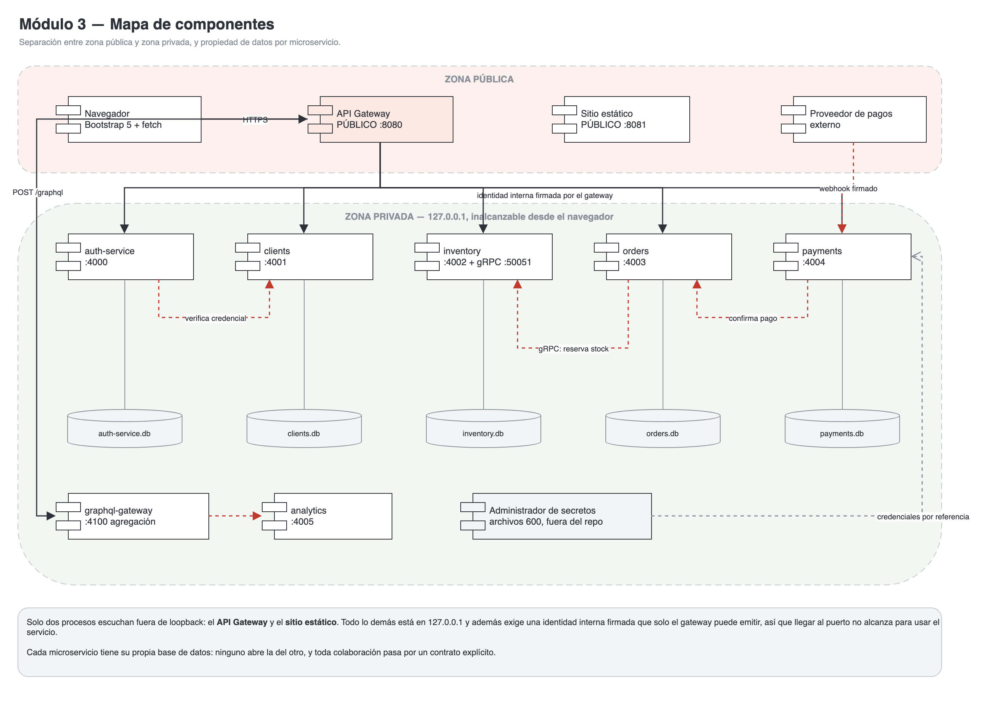

### Diagrama de secuencia

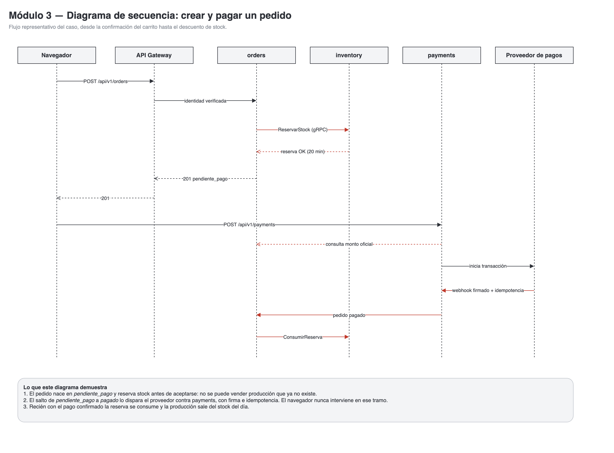

### Intercambio entre sistemas

**`orders` consulta a `inventory` antes de aceptar un ítem.** Se decidió
**reservar** y no solo consultar: con stock del día, entre que el cliente mira el
carrito y confirma pueden pasar minutos, y dos clientes podrían comprar la misma
bandeja. La reserva tiene vencimiento de 20 minutos; si el pago no llega, la
producción vuelve al catálogo sola. Si la respuesta no llega, el pedido no se crea.

**Para pagos, el aviso del proveedor se verifica por firma HMAC** antes de leer el
cuerpo, y se descarta si la clave de idempotencia ya fue procesada. El único
sistema que puede declarar un pago confirmado es `payments`, y el único que puede
pasar un pedido a `pagado` es `orders`, por una ruta interna que exige rol
`servicio`. El frontend no participa de ese tramo.

---

## 5. Módulo 4: Stakeholders y permisos HTTP

### Registro de stakeholders

| Nombre o categoría | Interés en el sistema | Rol asociado | Uso de información |
|---|---|---|---|
| **Visitante** | Ver qué pastas hay y a qué precio antes de decidir | `anonimo` | Lectura pública del catálogo. No ve datos de nadie |
| **Invitado** | Comprar sin crear cuenta | `invitado` | Arma carrito, compra y ve **solo los pedidos de su sesión**. Entrega un correo de contacto |
| **Cliente registrado** | Comprar, pagar, revisar su historial y anular | `cliente` | Lectura y escritura de sus propios pedidos y datos |
| **Administrador** | Mantener catálogo, stock y cuentas | `administrador` | Escritura sobre productos y cuentas; lectura global de pedidos |
| **Cajero virtual** | Confirmar ventas y emitir boletas | `cajero` | Lectura de pedidos y pagos; cambio de estado acotado |
| **Encargado de despacho** | Obtener la cola de preparación en orden de llegada | `despacho` | Lectura de pedidos pagados y su dirección de entrega |
| **Dueño** | Saber cuánto se vendió | `dueno` | **Solo lectura de reportes agregados.** No ve clientes ni pedidos individuales |
| **Choferes** | Entregar los pedidos | *Sin permisos operativos* | Reciben la orden de despacho impresa por el encargado. No entran al sistema |
| **Proveedor de pagos** | Informar el resultado del cobro | Identidad técnica | Escritura **únicamente** del estado de un pago, vía webhook firmado |
| **Proveedor de correo** | Validar casillas y enviar boletas | Identidad técnica | No lee nada del sistema; recibe encargos de envío |

### Matriz de permisos por ruta

| Rol / Identidad | ID de servicio | Ruta | Verbo | Decisión | Alcance y condición | Lugar donde se verifica |
|---|---|---|---|---|---|---|
| Anónimo, todos | S01 | `/api/v1/products` | **GET** | Permitido | Solo campos públicos del catálogo | API Gateway → `inventory` |
| Administrador | S05 | `/api/v1/products` | **POST** | Permitido | Solo el administrador da de alta productos | API Gateway valida el rol |
| Cliente | S05 | `/api/v1/products` | **POST** | **Denegado** | Consultar el catálogo no otorga permisos de administración | Rechazado en el API Gateway (403) |
| Administrador | S08 | `/api/v1/products/{id}` | **DELETE** | Permitido | Retiro lógico; 409 si tiene reservas vigentes | `inventory` |
| Cliente, invitado | S08 | `/api/v1/products/{id}` | **DELETE** | **Denegado** | — | Rechazado en el API Gateway |
| Anónimo | S09 | `/api/v1/clients` | **POST** | Permitido | Creación de cuenta nueva, rol `cliente` fijo | `clients` |
| Anónimo | S09 con `rol: administrador` | `/api/v1/clients` | **POST** | **Denegado** | Solo un administrador puede crear cuentas con otro perfil | `clients` (403) |
| Cliente, invitado | S21 | `/api/v1/orders` | **POST** | Permitido | El pedido se arma con **su** carrito; los totales los calcula el servidor | `orders` |
| Cliente, invitado | S23 | `/api/v1/orders/{id}` | **GET** | Permitido **solo si** le pertenece | Si no le pertenece responde **404**, no 403, para no confirmar que existe | `orders` compara `cliente_id` con la identidad propagada |
| Despacho, administrador | S26 | `/api/v1/dispatch/orders` | **GET** | Permitido | Solo pedidos pagados o en preparación | API Gateway + `orders` |
| Cliente | S24 | `/api/v1/orders/{id}/cancellation` | **POST** | Permitido con condición | Solo si es suyo y el estado lo permite. Una vez en cocina, solo el administrador | `orders` |
| Cualquiera | S24 | `/api/v1/orders/{id}` | **DELETE** | **No aplica: la ruta no existe** | Ver justificación abajo | No está en la tabla de rutas |
| Administrador, cajero | S25 | `/api/v1/orders/{id}/status` | **PUT** | Permitido salvo un valor | Puede avanzar el pedido, pero **no** a `pagado` | `orders` responde 403 `reservado_a_payments` |
| Dueño, administrador | S31 | `/api/v1/reports/sales` | **GET** | Permitido | Totales agregados, sin datos de clientes | API Gateway + `analytics` |
| Cliente | S31 | `/api/v1/reports/sales` | **GET** | **Denegado** | El reporte es información de gestión | API Gateway (403) |
| Proveedor de pagos | S28 | `/api/v1/payments/webhook` | **POST** | Permitido | Solo peticiones con firma HMAC válida e idempotencia | `payments` valida la firma; el gateway solo enruta y limita |
| Invitado | S15 | `/api/v1/clients` | **GET** | **Denegado** | Comprar no otorga acceso al mantenedor | API Gateway (403) |

### Justificación de anulación frente a eliminación

El verbo `DELETE` está **ausente de la tabla de rutas** para los pedidos. No es que
esté denegado: la ruta sencillamente no se publica, de modo que una petición a
`DELETE /api/v1/orders/{id}` recibe un 404 de ruta no publicada.

Anular un pedido no equivale a borrar el registro. El negocio necesita el histórico
por tres motivos concretos: el RF3 exige **conservar el motivo** de la anulación,
el RF9 necesita que el reporte de ventas no cambie retroactivamente, y la
producción reservada debe devolverse al stock del día de forma trazable.

Por eso la anulación es `POST /api/v1/orders/{id}/cancellation`: crea un registro
nuevo con motivo, autor, rol y fecha, cambia el estado del pedido a `anulado` y
libera la reserva en `inventory`. El pedido sigue siendo consultable. La
comprobación de que el cliente A no anula el pedido del cliente B la hace `orders`
comparando el `cliente_id` de la fila con el identificador que el gateway propagó
en la identidad interna, no con un dato del cuerpo.

Ocultar el botón en el frontend no cumple ninguna de estas reglas: todas se
verifican en el servidor.

---

## 6. Módulo 5: Clases del API Gateway

### Diagrama UML del gateway

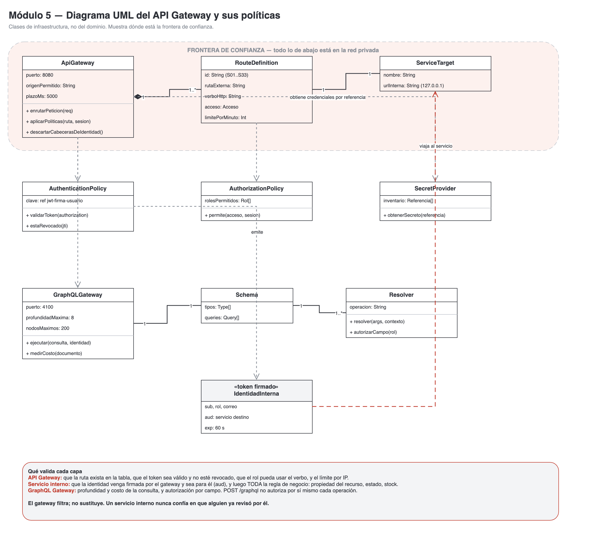

### Decisión sobre cuántos gateways

Se usa **un solo API Gateway público**. Separar rutas por políticas dentro de un
gateway es suficiente para este caso: la tabla `RUTAS` distingue acceso anónimo,
autenticado, por rol e identidad de proveedor, y aplica un límite distinto a cada
ruta. Un segundo gateway público solo se justificaría si hubiera dominios con
ciclos de despliegue o requisitos de red distintos, y aquí no los hay.

El **GraphQL Gateway es privado** y vive detrás del API Gateway, no al lado. El
navegador llega a él solo por `POST /graphql`, y esa ruta no autoriza por sí misma:
cada operación, recurso y campo se vuelve a controlar adentro.

### Políticas y fronteras de confianza

La red se divide en dos zonas. En la pública solo escuchan el API Gateway (`:8080`)
y el sitio estático (`:8081`). Todo lo demás —seis microservicios y el GraphQL
Gateway— se enlaza a `127.0.0.1` y, además, exige una **identidad interna firmada**
que solo el gateway puede emitir, con el servicio de destino en el campo `aud` y
una vida de 60 segundos.

Esto significa que llegar al puerto no alcanza. Un proceso en la misma máquina que
llame a `http://127.0.0.1:4002/products` recibe `401 sin_identidad_interna`.

El gateway **descarta** cualquier cabecera `x-identidad-interna`, `x-user-id` o
`x-rol` que venga del navegador antes de procesar la petición. Lo que llega del
cliente nunca se reenvía como identidad.

**Qué valida cada capa:**

| Capa | Qué comprueba |
|---|---|
| API Gateway | Que la ruta exista en la tabla; que el token sea válido, no esté expirado ni revocado; que el rol pueda usar ese verbo en esa ruta; el límite de solicitudes por IP; el plazo máximo de 5 s |
| Servicio interno | Que la identidad venga firmada y sea para él (`aud`); y después **toda** la regla de negocio: propiedad del recurso, estado del pedido, stock disponible, rango de los campos |
| GraphQL Gateway | Profundidad (máx. 8) y costo (máx. 200 nodos) de la consulta; autorización por operación y por campo |

El gateway filtra, no sustituye. Ningún servicio interno confía en que alguien ya
revisó por él.

**El mismo servicio, llamado directo a su puerto privado**, sin pasar por el
gateway. No hay forma de fabricar la identidad interna desde el navegador:

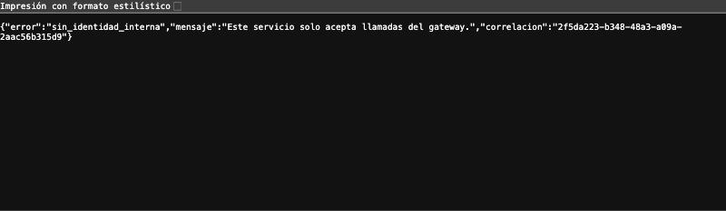

**Una ruta interna consultada desde fuera** ni siquiera existe para el mundo
exterior, porque no está en la tabla de rutas:

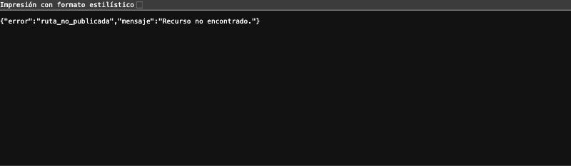

### Recorrido de una solicitud autorizada

1. Un cliente autenticado envía `GET /api/v1/orders/ped_123` con su token.
2. El API Gateway busca la `RouteDefinition` S23 y descarta las cabeceras de
   identidad que trajera el navegador.
3. La `AuthenticationPolicy` verifica la firma HS256 del token y consulta a
   `auth-service` si ese `jti` fue revocado.
4. La `AuthorizationPolicy` comprueba que el acceso `autenticado` admite el rol.
5. El límite de solicitudes de esa ruta e IP no está excedido.
6. El gateway emite una `IdentidadInterna` con `sub`, `rol` y `aud: orders`, y
   enruta al `ServiceTarget` `http://127.0.0.1:4003/orders/ped_123`.
7. `orders` valida la identidad, comprueba que `cliente_id` coincide con `sub` y
   responde 200.

### Recorrido de una solicitud denegada

1. Un usuario con rol `cliente` envía `POST /api/v1/products`.
2. El gateway encuentra la ruta S05, cuyo acceso es `['administrador']`.
3. La `AuthorizationPolicy` detecta que el rol no está en la lista.
4. Devuelve **403** con el mensaje `Su perfil no tiene permiso para esta operacion`,
   sin detalle interno y con identificador de correlación.
5. La petición **nunca llega** a `inventory`.

---

## 7. Módulo 6: Rutas y secretos de integración

### Matriz de rutas

La tabla completa, generada desde el propio sistema, está en
`docs/evidencias/rutas-y-secretos.json`, que es la respuesta de
`GET /api/v1/_rutas`. Extracto representativo:

| ID | Gateway | Verbo | Ruta externa | Acceso y rol | Sistema y ruta destino | Controles | Ref. de credencial |
|---|---|---|---|---|---|---|---|
| S01 | API-GW | GET | `/api/v1/products` | Anónimo | `inventory` → `/products` | Validación de filtros; límite 120/min por IP | `identidad-interna` |
| S09 | API-GW | POST | `/api/v1/clients` | Anónimo | `clients` → `/clients` | Validación de RUN, correo y edad; límite 5/min | `identidad-interna` |
| S11 | API-GW | POST | `/api/v1/auth/login` | Anónimo | `auth` → `/auth/login` | Límite 30/min por IP **y** 5 fallos/15 min por cuenta | `jwt-firma-usuario` |
| S32 | API-GW | POST | `/api/v1/auth/invitado` | Anónimo | `auth` → `/auth/invitado` | Formato de correo; límite 20/min | `jwt-firma-usuario` |
| S21 | API-GW | POST | `/api/v1/orders` | Cliente o invitado | `orders` → `/orders` | Verificación de firma del token; identidad propagada; límite 20/min | `identidad-interna` |
| S23 | API-GW | GET | `/api/v1/orders/{id}` | Autenticado | `orders` → `/orders/{id}` | Propiedad del recurso comprobada en el servicio | `identidad-interna` |
| S28 | API-GW | POST | `/api/v1/payments/webhook` | Proveedor externo | `payments` → `/payments/webhook` | Firma HMAC e idempotencia verificadas en `payments`; el gateway reenvía las cabeceras intactas | `pagos-webhook` |
| S31 | API-GW | GET | `/api/v1/reports/sales` | Dueño o administrador | `analytics` → `/reports/sales` | Rango máximo de un año | `identidad-interna` |
| — | API-GW | POST | `/graphql` | Anónimo o autenticado | `graphql-gateway` → `/graphql` | Límite de profundidad y costo; autorización por campo | `identidad-interna` |

**Rutas internas que no se publican.** Están declaradas explícitamente para dejar
constancia de que su ausencia es una decisión:

`clients /internal/credenciales/verificar` · `clients /internal/clients/{id}` ·
`auth /internal/revocada/{jti}` · `inventory /internal/precios` ·
`inventory /internal/reservas` · `orders /internal/orders/{id}` ·
`orders /internal/orders/{id}/pagado` · `orders /internal/ventas` ·
`analytics /internal/resumen-hoy` · el servicio gRPC completo en `127.0.0.1:50051`.

### Operaciones GraphQL

| Operación | Tipo | Campos autorizados | Resolver | Subsistemas consultados |
|---|---|---|---|---|
| `resumenPedido(id)` | Query | `id, estado, subtotal, costoDespacho, total, ventanaDespacho, creadoEn, items{...}, anulacion{...}`; y solo para el propietario o el personal: `nombreCliente`, `direccionEntrega` | `resumenPedido` | `orders` (cabecera y líneas), `inventory` (descripción vigente, en **una** llamada en lote), `clients` (nombre) |
| `portada` | Query | `horaCorte, categorias{...}, productosDelDia{...}, misUltimosPedidos{...}` | `portada` | `inventory` (productos del día y categorías) y `orders` (últimos pedidos del solicitante) |
| `panelDueno` | Query | `dia, totalVentas, cantidadPedidos, pedidosEnCola` | `panelDueno` | `analytics` (modelo de lectura) y `orders` (cola de despacho) |

No hay *mutations*: las reglas transaccionales se quedan en los servicios de
negocio. Este gateway solo compone lecturas.

### Inventario simbólico de secretos

Ningún valor aparece en el repositorio ni en este informe. Los archivos viven en
`backend/secrets/` con permisos `600`, están excluidos por `.gitignore` y el código
los referencia por nombre.

| Referencia | Tipo | Emisor | Consumidor | Finalidad | Ubicación segura | Alcance | Rotación y revocación |
|---|---|---|---|---|---|---|---|
| `jwt-firma-usuario` | Clave simétrica HS256 | `auth-service` | `auth-service`, `api-gateway` | Firmar y validar el token de sesión | Archivo `600` fuera del repositorio; en producción, gestor de secretos | Solo tokens de sesión; **no** sirve para llamadas entre servicios | Cada 90 días o ante incidente, con período de gracia de 15 min |
| `identidad-interna` | Clave simétrica HS256 | `api-gateway` | Gateway y microservicios privados | Propagar identidad verificada hacia la red privada | Ídem | Red privada; un token interno **no** es válido como sesión de usuario | Cada 30 días; los servicios aceptan la clave anterior durante 10 min |
| `pagos-webhook` | Secreto compartido HMAC | Proveedor de pagos | `payments` | Verificar la firma de la notificación de pago | Ídem | Solo verificación de firma entrante; **no autoriza cobrar** | La define el proveedor; revocación inmediata ante filtración |
| `correo-api` | Credencial de servicio | Proveedor de correo | `clients` (RF11) y `payments` (RF8) | Validar casillas y enviar boletas | Ídem | Permisos mínimos de envío y validación, sin acceso a la bandeja | Cada 180 días |

### Decisiones de seguridad sobre los secretos

Cada tramo usa una credencial distinta y con el alcance mínimo. La clave que firma
sesiones de usuario no sirve para hablar entre servicios, y al revés: si una se
filtra, no se cae todo el sistema.

La credencial de la base de datos pertenece al servicio que accede a ella. En este
despliegue cada microservicio abre su propio archivo, protegido por permisos del
sistema de archivos; ni el navegador ni el gateway tienen forma de abrirlo.

El gateway descarta las cabeceras de identidad que aporte el navegador y transmite
únicamente contexto verificado. No hay secretos en rutas, parámetros de consulta,
repositorio ni capturas. Los registros se filtran: `shared/http.js` omite cualquier
campo cuyo nombre contenga `password`, `clave`, `token`, `secret`, `authorization`,
`firma` o `run`.

**Si una clave se filtra:** se rota con `npm run secrets -- --rotar`, lo que
invalida todas las sesiones vigentes. **Si el gestor de secretos no responde:** los
servicios no arrancan, por diseño; es preferible no levantar a levantar sin poder
verificar firmas.

---

## 8. Módulo 7: Datos sensibles y secretos del cliente

### Clasificación de datos

| Dato o credencial | Finalidad | Clasificación | Sistema custodio | Roles autorizados | Representación en frontend | Protección | Retención |
|---|---|---|---|---|---|---|---|
| Contraseña del usuario | Autenticación | **Credencial** | `clients` | Ninguno: ni el administrador la ve | No se muestra nunca; campo `type=password` | **Hash adaptativo scrypt con sal** (N=16384, r=8, p=1). No es cifrado: es irreversible | Hasta el cierre de la cuenta |
| RUN | Identificar al cliente, exigido por el RF5 | Dato personal (Restringido) | `clients` | El propio cliente y el administrador | **Enmascarado**: `12.***.***-5` | En reposo en la base del servicio; nunca sale completo por la API | Hasta el cierre de la cuenta |
| Dirección de entrega | Llevar el pedido al lugar correcto | Dato personal (Restringido) | `clients` y `orders` | El propietario, el administrador y el encargado de despacho | Texto completo solo en su propio pedido | No aparece en el catálogo público ni en los logs | Se conserva en el pedido histórico aunque el cliente borre su cuenta, por integridad contable |
| Correo electrónico | Contacto, verificación (RF11) y boleta (RF8) | Dato personal (Restringido) | `clients`; `orders` para invitados | El propietario y el personal autorizado | Visible solo en su perfil | Excluido de los registros | Hasta el cierre de la cuenta |
| Historial de pedidos | Que el cliente vea sus compras | Dato personal (Restringido) | `orders` | Solo el propietario y el personal | Lista en "Mis pedidos" | Comprobación de propiedad en cada consulta; 404 si no le pertenece | Permanente, por el RF9 |
| Token de sesión | Mantener la sesión | Credencial | `auth-service` lo emite | El propio usuario | `sessionStorage`, muere al cerrar la pestaña | HS256, vida de 15 min (1 h para invitado), revocable al salir | Hasta expirar o revocarse |
| Clave del proveedor de pagos | Verificar que el aviso de cobro es auténtico | **Secreto de integración** | `payments` | Ninguna persona | **Nunca llega al navegador** | Archivo `600` fuera del repositorio | Según el proveedor |
| Catálogo: nombre, precio, formato | Mostrar la oferta | **Dato público** | `inventory` | Todos, incluso anónimos | Texto completo e imágenes | Ninguna; caché público admitido | Permanente |
| Stock del día | Saber si alcanza | Dato público | `inventory` | Todos | "quedan 12" / "AGOTADO" | Ninguna | Se reinicia cada jornada |
| Totales de venta | RF9, decisiones del dueño | Agregado interno | `analytics` | Dueño y administrador | Gráfico y tabla de totales | **Sin datos personales**: solo sumas | Permanente |

### Decisión explícita sobre secretos del cliente

**¿Este sistema necesita custodiar secretos asociados al cliente? No.**

El sistema **no guarda ningún dato financiero del cliente**: ni número de tarjeta,
ni CVV, ni token de pago reutilizable. El cobro se delega íntegramente a la
plataforma externa, que devuelve solo un identificador de transacción y un estado.
Ese identificador no permite operar la cuenta de nadie.

La contraseña **no es un secreto custodiado**, es una credencial protegida: se
guarda como hash irreversible con sal, no cifrada. Cifrar implicaría poder
descifrar, y eso es justamente lo que no queremos.

Los datos personales del RF5 son **restringidos, no secretos**. Que aparezcan en una
pantalla no los vuelve públicos: la diferencia es quién puede pedirlos y qué
devuelve el servicio.

### Recorrido de un dato restringido: la dirección de entrega

1. **Captura.** El cliente la escribe en el carrito y viaja al API Gateway.
2. **Enrutamiento.** El gateway no la lee ni la registra; la reenvía a `orders`
   junto con la identidad verificada.
3. **Validación.** `orders` comprueba longitud y que la comuna esté dentro del radio
   de 3 km. Si no lo está, rechaza con 409 y la dirección no se guarda.
4. **Almacenamiento.** Queda en la fila del pedido, en la base de `orders`. Ningún
   otro servicio la lee.
5. **Uso.** Aparece en "Mis pedidos" solo para su dueño, y en la cola de despacho
   para el encargado, que la necesita para repartir.
6. **Exclusión de registros.** El filtro de `shared/http.js` la deja fuera de los
   logs.
7. **Conservación.** Si el cliente cierra su cuenta, se elimina de `clients`, pero
   **permanece en los pedidos ya emitidos**, porque la boleta es un documento
   contable que no se puede alterar. Esa asimetría es deliberada y está declarada.

### Casos de validación ejecutados

Todos corren contra el backend levantado con `npm test`. Salida completa en
`docs/evidencias/pruebas.txt`.

| # | Caso | Entrada e identidad | Resultado esperado y obtenido | Componente que lo verifica |
|---|---|---|---|---|
| 1 | Acceso anónimo a catálogo | `GET /api/v1/products` sin token | **200** con la lista pública | API Gateway |
| 2 | Operación protegida sin sesión | `GET /api/v1/cart` sin token | **401 `no_autenticado`** | API Gateway |
| 2b | Token manipulado | Payload alterado a `rol: administrador`, firma original | **401**: la firma no valida | API Gateway |
| 3 | Administración desde rol sin permiso | `POST /api/v1/products` como `cliente` | **403 `sin_permiso`** | API Gateway |
| 4 | Consulta de un pedido ajeno | Ana pide el pedido de Juan | **404**, y la respuesta **no contiene** la dirección de Juan | `orders` |
| 4b | El mismo pedido ajeno por GraphQL | `resumenPedido(id)` del pedido de Juan | **`null`**: seleccionar campos no evade la propiedad | GraphQL Gateway + `orders` |
| 5 | Acceso directo al backend | `GET` a los puertos 4000–4100 sin identidad | **401** en los siete servicios | Identidad interna |
| 5b | Identidad interna falsificada | Cabecera `x-identidad-interna` inventada desde el navegador | Se descarta; sigue siendo anónimo → **401** | API Gateway |
| 6 | Confirmar pago desde el frontend | Administrador intenta `PUT .../status` a `pagado` | **403 `reservado_a_payments`** | `orders` |
| 6b | Aviso de pago con firma inválida | Webhook con firma falsa | **401 `firma_invalida`** | `payments` |
| 6c | Aviso de pago con monto alterado | Webhook aprobado por $100 sobre un pedido de $9.980 | **409 `monto_no_coincide`** | `payments` |
| 6d | Aviso repetido | Mismo `X-Idempotency-Key` dos veces | **200 `ya_procesada`**, sin doble efecto | `payments` |
| 7 | Consulta GraphQL excesiva | Anidamiento sobre el límite de profundidad | **400** por consulta demasiado costosa | GraphQL Gateway |
| 8 | Panel del dueño desde rol cliente | `panelDueno` con sesión de cliente | `null` y error de permiso | GraphQL Gateway |
| 9 | Enumeración de cuentas | Login con correo inexistente y con clave incorrecta | **Respuesta idéntica** en ambos casos | `clients` |
| 10 | Revocación de sesión | Logout y reutilización del token | **401**: el token revocado no sirve | `auth` + API Gateway |
| 11 | Fuga de secretos por diagnóstico | `GET /api/v1/_rutas` | Aparecen las **referencias**, nunca los valores | API Gateway |
| 12 | Ruta interna publicada por descuido | `GET /internal/precios` desde fuera | **404 `ruta_no_publicada`** | API Gateway |
| 13 | Validación de entrada | RUN con dígito verificador incorrecto | **422 `run_digito_invalido`** | `clients` |
| 14 | Aislamiento entre invitados | Dos sesiones de invitado con el **mismo correo** | La segunda **no ve** los pedidos de la primera | `auth` + `orders` |
| 15 | Descuento reclamado por el cliente | `POST /orders` con `descuento: 999999, total: 1` | Ambos ignorados; el servidor recalcula | `orders` |

**Resultado: 45 pruebas, 45 pasando, 0 fallos.**

---

## 9. Módulo 8: Separación privada y agregaciones GraphQL

### Mapa de clasificación

| Servicio | Naturaleza | Responsabilidad | Datos propios | Contrato | Dependencias | Justificación de separación |
|---|---|---|---|---|---|---|
| `inventory` | Transaccional + alta demanda de lectura | Catálogo y stock del día | Productos, categorías, reservas | REST + gRPC | Ninguna | Aísla el tráfico de lectura del catálogo, que es el más alto y el único anónimo, del resto del negocio |
| `orders` | Transaccional | Ciclo de vida del pedido | Carritos, pedidos, anulaciones | REST, cliente gRPC | `inventory` | Centraliza las reglas de venta. Si otro servicio cae, el pedido no se pierde ni cambia de estado solo |
| `clients` | Transaccional | Identidad y perfiles | Cuentas, hash de contraseñas, datos personales | REST | Ninguna | Encapsula el riesgo: todos los datos personales y las credenciales quedan en un solo servicio, con una sola superficie que auditar |
| `payments` | Transaccional + integración externa | Relación con la pasarela | Pagos, notificaciones, boletas | REST + webhook | Proveedor externo | Aísla las esperas y caídas del proveedor para que no bloqueen la venta |
| `auth-service` | Transaccional | Emisión y revocación de sesiones | Tokens revocados | REST | `clients` | Separa emitir sesiones de custodiar credenciales: `auth` no guarda contraseñas |
| `analytics` | **Analítica** | Modelo de lectura de ventas | Agregados por día y por producto | REST | `orders` | Saca las consultas de rango del camino transaccional. Acepta un retraso de hasta 5 minutos a cambio de no competir con las ventas |
| `graphql-gateway` | **Agregación** | Componer lecturas para el frontend | Ninguno: es compositor | GraphQL | `orders`, `inventory`, `clients`, `analytics` | Evita que la pantalla haga cinco llamadas y que el navegador conozca los subsistemas |
| `api-gateway` | Borde | Única superficie pública | Tabla de rutas | HTTP | Todos | Concentra autenticación, autorización por ruta, límites y plazos |

Ningún servicio escribe datos de otro. Las colaboraciones son contratos explícitos,
y la agregación **no** autoriza a leer la base de nadie.

### Esquema GraphQL

```graphql
type Producto {
  id: ID!
  nombre: String!
  formato: String!
  precio: Int!
  disponible: Boolean!
  stockDelDia: Int!
  imagenUrl: String
}

type ItemPedido {
  productoId: ID!
  nombre: String!
  formato: String!
  cantidad: Int!
  precioUnitario: Int!
  subtotal: Int!
  "Descripcion vigente del catalogo: viene de inventory, no de orders."
  productoVigente: Producto
}

type ResumenPedido {
  id: ID!
  estado: String!
  subtotal: Int!
  costoDespacho: Int!
  total: Int!
  ventanaDespacho: String
  creadoEn: String!
  items: [ItemPedido!]!
  anulacion: Anulacion
  "Solo se entrega al propio cliente o al personal autorizado."
  nombreCliente: String
  direccionEntrega: String
}

type Portada {
  productosDelDia: [Producto!]!
  categorias: [Categoria!]!
  horaCorte: String!
  misUltimosPedidos: [ResumenPedido!]!
}

type Query {
  resumenPedido(id: ID!): ResumenPedido
  portada: Portada!
  panelDueno: PanelDueno
}
```

### Resolvers

`Query.resumenPedido` llama primero a `orders` por la ruta interna del pedido.
`orders` aplica su propia comprobación de propiedad: si el pedido no es del
solicitante responde 404 y el resolver devuelve `null` sin componer nada.

Si el pedido sí le corresponde, el resolver extrae los identificadores de producto
de **todas** las líneas y hace **una sola llamada en lote** a `inventory`
(`POST /internal/precios` con el arreglo de identificadores), evitando el patrón de
una petición por ítem. Por último pide a `clients` el nombre del comprador y une
los tres resultados.

`Query.portada` lanza en paralelo las llamadas a `inventory` y, si hay sesión, a
`orders`. Si `inventory` no responde, la portada devuelve lista vacía en vez de
fallar entera: el error es parcial, no total.

### Consulta de prueba y respuesta

Consulta:

```graphql
query($id: ID!) {
  resumenPedido(id: $id) {
    id estado total nombreCliente
    items {
      nombre cantidad precioUnitario
      productoVigente { nombre disponible stockDelDia }
    }
  }
}
```

Respuesta esperada:

```json
{
  "data": {
    "resumenPedido": {
      "id": "ped_2026_0417",
      "estado": "pagado",
      "total": 9481,
      "nombreCliente": "Ana Perez Soto",
      "items": [
        {
          "nombre": "Ravioles de ricotta",
          "cantidad": 2,
          "precioUnitario": 4990,
          "productoVigente": { "nombre": "Ravioles de ricotta", "disponible": true, "stockDelDia": 10 }
        }
      ]
    }
  }
}
```

`nombre` y `precioUnitario` vienen de `orders`, congelados al confirmar.
`productoVigente` viene de `inventory`, en vivo. `nombreCliente` viene de `clients`.
**La respuesta combina tres subsistemas que el navegador no sabe que existen.**

### Matriz de autorización GraphQL

| Operación | Recurso / Campo | Rol permitido | Condición de autorización |
|---|---|---|---|
| `Query.resumenPedido` | Pedido | `cliente`, `invitado` | El `sub` propagado por el gateway debe ser el dueño del pedido. Si no, `orders` responde 404 y el resolver devuelve `null` |
| `Query.resumenPedido` | Pedido | `administrador`, `cajero`, `despacho`, `dueno` | Permitido globalmente, para soporte y despacho |
| `Query.resumenPedido` | `nombreCliente`, `direccionEntrega` | Propietario o personal | Campos restringidos: solo se componen si `orders` ya autorizó el pedido |
| `Query.portada` | Productos y categorías | Cualquiera, incluso anónimo | Son datos públicos del catálogo |
| `Query.portada` | `misUltimosPedidos` | `cliente` | Lista vacía para un visitante; nunca pedidos de otro |
| `Query.panelDueno` | Totales de venta | `dueno`, `administrador` | Cualquier otro rol recibe `null` y un error de permiso |
| Cualquiera | — | — | Profundidad máxima 8 y 200 nodos. Una consulta más costosa se rechaza con 400 antes de ejecutarse |

### Evidencia de agregación

La home se arma **con una sola consulta GraphQL**. Productos del día, categorías y
hora de corte salen todos de `Query.portada`, que por dentro consulta `inventory` y
`orders`. El navegador jamás llama a esos subsistemas: solo conoce
`http://localhost:8080`.

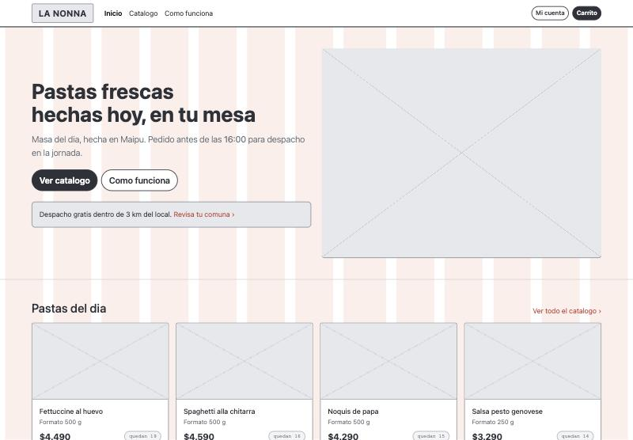

El **panel del dueño** es la segunda agregación: combina el modelo de lectura de
`analytics` con la cola de despacho de `orders`, y solo se compone si el rol lo
autoriza. Un cliente que pida la misma operación recibe `null` y un error de
permiso.

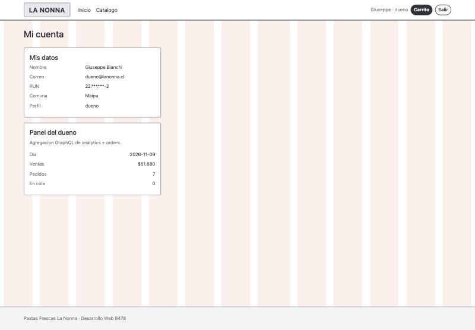

El caso 4b de la tabla de validaciones demuestra el control de autorización: un
cliente pidiendo `resumenPedido` de un pedido ajeno recibe `null`, aunque seleccione
exactamente los campos restringidos.

---

## 10. Módulo 9: Analítica y comunicación gRPC

### ADR de aplicabilidad

**Contexto.** El negocio necesita dos cosas que podrían justificar infraestructura
adicional: reportes de ventas por período para el dueño (RF9), y una reserva de
stock que se invoca en cada confirmación de pedido y está en el camino crítico de
la compra, con la particularidad de que la pasta fresca es producción del día y no
se puede vender dos veces.

**Alternativas evaluadas.**

1. REST para todo, incluida la reserva, y consultas SQL directas para el reporte.
2. Subsistema de big data para analítica y gRPC bidireccional generalizado.
3. Servicio de analítica propio con modelo de lectura, y gRPC interno acotado a la
   reserva de stock.

**Decisiones tomadas.**

- **Sobre analítica: aplicable de forma acotada, sin big data.** El volumen de una
  fábrica de pastas de barrio no se acerca a big data. Pero sí se separó un
  servicio `analytics` con su propio modelo de lectura, porque una consulta de
  rango anual sobre la base transaccional competiría con las ventas en hora punta.
  Acepta un retraso de hasta 5 minutos, que para un reporte de gestión es
  irrelevante.
  Al generar las evidencias de este informe se detectó y corrigió un error en
  este servicio: el modelo de lectura agrupaba por **día UTC**. Para un local en
  Chile eso parte la jornada en dos a partir de las 21:00, porque en UTC ya es el
  día siguiente, y el reporte del RF9 mostraba dos filas donde el negocio ve una.
  Ahora el día se calcula en hora local y el rango se convierte a instantes al
  consultar a `orders`. Hay cuatro pruebas que lo cubren en
  `tests/reportes.test.js`.
- **Sobre gRPC: aplicable de forma acotada.** Se implementó `ReservarStock`,
  `LiberarReserva` y `ConsumirReserva` como RPC *unary* entre `orders` e
  `inventory`. El resto del catálogo sigue en REST porque lo consume el navegador.

**Consecuencias.** Hay que mantener un contrato `.proto` y un servidor gRPC
adicional. Se agregó un **respaldo por REST**: si el canal gRPC no está disponible,
`orders` degrada al mismo contrato por HTTP en vez de dejar caer la compra. Un
rechazo de negocio (sin stock) **no** se reintenta por el otro canal, para no
reservar dos veces.

### Matriz de necesidades y caracterización

| Atributo | Caracterización para el caso | Justificación técnica |
|---|---|---|
| Volumen de datos | Bajo | Producción diaria de decenas de unidades por producto; los pedidos de un local no alcanzan volúmenes de big data |
| Concurrencia | Media con picos definidos | Se concentra antes de la hora de corte de las 16:00 |
| Tamaño de mensajes | Pequeño | Un pedido completo pesa pocos kilobytes |
| Frecuencia y latencia | Alta frecuencia y baja latencia en la reserva | Está en el camino crítico: el cliente espera mirando la pantalla |
| Necesidad de streaming | **No** | Nada en este caso requiere flujo continuo. No hay seguimiento de repartidor en vivo |

Por eso las tres RPC son *unary* y no *streaming*: el flujo no lo pide, y usar
streaming sin necesidad solo agregaría manejo de reconexión y control de flujo.

### Mediciones de carga

Herramienta propia, sin dependencias externas: `node scripts/prueba-carga.js`.
Salida completa en `docs/evidencias/prueba-carga.txt`.

| Métrica evaluada | Resultado obtenido | Objetivo / Esperado |
|---|---|---|
| Entorno y herramienta | Node v26 sobre macOS arm64, 18 núcleos, 24 GB; generador de carga propio | Localhost, Node |
| Concurrencia | 100 trabajadores en paralelo, 8 s por escenario | 100 usuarios simultáneos |
| Latencia p95 — catálogo interno | **11,69 ms** | Menor a 200 ms ✔ |
| Latencia p95 — reserva por gRPC | **30,18 ms** | Menor a 200 ms ✔ |
| Latencia p95 — reserva por REST | **30,82 ms** | Menor a 200 ms ✔ |
| Throughput — catálogo interno | **11.381 req/s** | 500 req/s ✔ |
| Throughput — reserva por gRPC | **3.739 req/s** | 500 req/s ✔ |
| Errores | **0 %** en los tres escenarios | 0 % bajo carga normal ✔ |
| Consumo CPU / memoria | 25,1 s de CPU de usuario; RSS del generador de 79 MB a 250 MB, estable | Estable, sin fugas |

**El límite de solicitudes del gateway se midió aparte y funcionó.** Al lanzar
255.394 peticiones al catálogo desde una sola IP, el gateway **aceptó 120 y rechazó
255.274 con 429** — exactamente el límite configurado de 120/min para esa ruta. No
son errores: es el control haciendo su trabajo. Por eso la capacidad real del
backend se midió contra el servicio interno, sin el tope por IP.

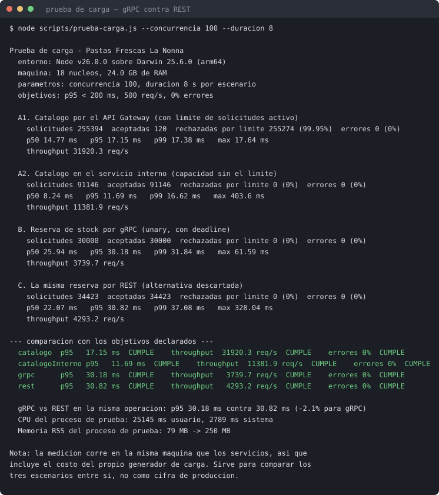

### Justificación de la decisión, a la luz de la medición

**gRPC no resultó más rápido que REST en este caso.** p95 de 30,18 ms contra
30,82 ms: una diferencia de 2,1 % que está dentro del ruido entre corridas, y en
throughput REST incluso salió por delante (4.293 contra 3.739 req/s).

Sería deshonesto justificar gRPC por rendimiento. La justificación es otra, y es
la que corresponde a una RPC *unary* interna:

1. **Contrato tipado.** El `.proto` define mensajes y tipos; un cambio incompatible
   se detecta al compilar el cliente, no en producción.
2. **Plazo máximo explícito.** El *deadline* de 2 s es parte de la llamada, no una
   convención que cada quien recuerde poner.
3. **Separación de fallas.** Un rechazo de negocio (`stock_insuficiente`) viaja en
   el mensaje de respuesta; una falla de transporte viaja como código gRPC. En REST
   ambas llegan como códigos HTTP y hay que distinguirlas por convención.

**Lo que la medición sí descarta** es la necesidad de un subsistema de big data: con
11.381 req/s de capacidad de lectura y p95 de 12 ms, el cuello de botella de este
negocio no está en la infraestructura de datos.

### Contrato `.proto`

```protobuf
syntax = "proto3";
package lanonna.inventario;

service Inventario {
  rpc ReservarStock  (SolicitudReserva) returns (RespuestaReserva);
  rpc LiberarReserva (SolicitudPedido)  returns (RespuestaLiberacion);
  rpc ConsumirReserva(SolicitudPedido)  returns (RespuestaLiberacion);
}

message ItemReserva { string producto_id = 1; int32 cantidad = 2; }

message SolicitudReserva {
  string               pedido_id   = 1;
  repeated ItemReserva items       = 2;
  string               correlacion = 3;
}

message RespuestaReserva {
  bool                   ok                   = 1;
  string                 codigo               = 2;
  repeated ReservaCreada reservas             = 3;
  string                 expira_en            = 4;
  string                 producto_id_problema = 5;
  int32                  disponible           = 6;
}
```

**Seguridad del canal gRPC.** Escucha en `127.0.0.1:50051` y exige la misma
identidad interna firmada que el canal HTTP, enviada como metadato
`x-identidad-interna` con `aud: inventory`. Un llamante sin credencial válida recibe
`UNAUTHENTICATED`, no un error de negocio. En un despliegue real este canal usaría
mTLS; aquí va sin cifrar porque no sale de loopback, y eso está declarado como
brecha.

---

## 11. Módulo 10: Backend completo e integración verificable

### Instrucciones de despliegue

**Requisitos previos:** Node.js 22.5 o superior. Nada más: `node:sqlite` viene
incluido en Node y no hay módulos nativos que compilar.

```bash
cd backend
npm install
npm run secrets     # genera los secretos locales con permisos 600
npm run migrate     # crea el esquema: una base por microservicio
npm run seed        # datos de prueba ficticios
npm start           # levanta los nueve procesos
```

El sitio queda en `http://localhost:8081` y la API en `http://localhost:8080`.

**Para detener el sistema:** `Ctrl+C` en la terminal de `npm start` baja el
conjunto completo. **Para rotar secretos:** `npm run secrets -- --rotar`. **Para
partir de cero:** borrar `backend/data/` y repetir `migrate` y `seed`.

**Puertos y visibilidad:**

| Proceso | Puerto | Visibilidad |
|---|---|---|
| `api-gateway` | 8080 | **Público** |
| Sitio estático | 8081 | **Público** |
| `auth`, `clients`, `inventory`, `orders`, `payments`, `analytics` | 4000–4005 | Privado (`127.0.0.1`) |
| `inventory` gRPC | 50051 | Privado |
| `graphql-gateway` | 4100 | Privado |

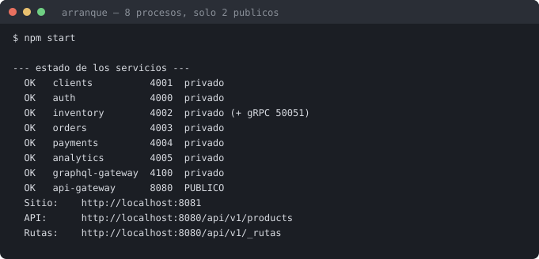

### Persistencia

Persistencia real en disco con SQLite a través de `node:sqlite`, en modo WAL y con
claves foráneas activas. **Una base por microservicio**, en `backend/data/`:
`auth.db`, `clients.db`, `inventory.db`, `orders.db`, `payments.db` y
`analytics.db`. La propiedad de datos es literal: `inventory` no puede leer
`orders.db` porque nunca abre ese archivo.

Los esquemas están en `services/<servicio>/esquema.sql` y los aplica
`scripts/migrar.js`, que además ejecuta las columnas agregadas después de la primera
versión de forma idempotente. Los datos de prueba, todos ficticios, los carga
`scripts/sembrar.js`: 6 cuentas, 5 categorías, 26 productos y 40 comunas.

No hay respuestas fijas ni simulación en memoria: cada operación escribe y lee de
su base, dentro de transacciones donde corresponde.

### Flujos: matriz de validación

| Requisito | Pantalla | Servicio | Prueba realizada | Resultado esperado y obtenido | Evidencia |
|---|---|---|---|---|---|
| RF1 | P02 Catálogo | S01 | Consumir el catálogo sin token | 200 con la lista pública | Anexos 1 y 5 |
| RF1 | P02 | S18 | Agregar al carrito enviando `precioUnitario: 1` | El servidor ignora el precio del navegador y usa 4990 | Anexo 9 |
| RF7 | P02 | S18 | Agregar un producto agotado | 409 `stock_insuficiente` | Anexo 9 |
| Despacho | P03 Carrito | S21 | Pedir con comuna fuera del radio | 409 `fuera_de_radio` | Anexo 9 |
| RF1 | P03 | S21 | Confirmar pedido | 201 `pendiente_pago` con stock reservado y vencimiento | Anexo 9 |
| RF2 | P08 Admin | S25 | Pasar a `en_preparacion` sin pago | 409 `transicion_invalida` | Anexo 9 |
| RF2 | — | S25 | Administrador intenta marcar `pagado` | **403 `reservado_a_payments`** | Anexo 9 |
| RF2 | — | S28 | Webhook con firma falsa | 401 `firma_invalida` | Anexo 9 |
| RF2 | — | S28 | Webhook con monto alterado | 409 `monto_no_coincide` | Anexo 9 |
| RF2 | — | S28 | Mismo webhook dos veces | 200 `ya_procesada`, sin doble efecto | Anexo 9 |
| RF8 | P06 | S30 | Consultar boleta tras el pago | 200, emitida por `cajero_virtual` | Anexo 9 |
| RF13 | P09 Despacho | S26 | Cola tras confirmar el pago | El pedido aparece en orden de llegada | Anexo 9 |
| RF3 | P07 Mis pedidos | S24 | Anular con motivo | 200; el pedido **sigue existiendo** en estado `anulado` con su motivo | Anexo 9 |
| RF12 | P05 Login | S11 | Correo inexistente vs. clave incorrecta | Respuesta **idéntica**: no se pueden enumerar cuentas | Anexo 9 |
| RF12 | header | S12 | Reutilizar el token tras salir | 401: revocado | Anexo 9 |
| RF5 | P04 Registro | S09 | RUN con dígito verificador inválido | 422 `run_digito_invalido` | Anexo 9 |
| RF4 adaptado | P03 | S32 | Comprar como invitado con solo el correo | Pedido creado y boleta emitida al correo de contacto | Anexos 6, 7 y 9 |
| RF4 adaptado | — | S32 | Dos invitados con el mismo correo | El segundo **no ve** los pedidos del primero | Anexo 9 |
| Promoción | P03 | S21 | Primera y segunda compra de una cuenta nueva | 5 % solo en la primera; no reclamable desde el navegador | Anexo 9 |
| Módulo 8 | P01 Home | G02 | Cargar la portada | Una sola consulta GraphQL arma la pantalla completa | Anexos 4 y 8 |
| Módulo 8 | P07 | G01 | `resumenPedido` de un pedido ajeno | `null`, sin filtrar datos | Anexo 9 |
| Módulo 5 | — | — | Acceso directo a los puertos privados | 401 en los siete servicios | Anexo 2 |
| Módulo 6 | — | — | Consultar la tabla de rutas y secretos | Referencias sí, valores nunca | `rutas-y-secretos.json` |
| RF9 | P10 Reporte | S31 | Venta pagada ahora, consultada en el reporte del día | Aparece en la jornada **local**, en una sola fila | Anexo 9 |
| RF9 | P10 | S31 | Revisar el contenido del reporte | No contiene correo, dirección, RUN ni identificador de cliente | Anexo 9 |
| RF9 | P10 | S31 | Rango invertido y rango de 6 años | 400 `rango_invalido` y 400 `rango_excedido` | Anexo 9 |
| RF9 | P10 | S31 | Cliente pidiendo el reporte | 403 | Anexo 9 |
| Módulo 9 | — | — | Prueba de carga con 100 concurrentes | p95 bajo objetivo, 0 % de errores, límite de solicitudes funcionando | Anexo 10 |

### Condición de completitud

El informe describe la implementación entregada, no un diseño aparte. Cada matriz
de este documento corresponde a código que corre: la tabla de rutas del Módulo 6 es
`gateways/api-gateway/rutas.js`, el inventario de secretos del Módulo 6 es
`shared/secretos.js`, el contrato del Módulo 9 es `proto/inventario.proto`, y los
casos de validación del Módulo 7 son `tests/seguridad.test.js`.

---

## Anexos: evidencias de ejecución del backend

Todas las capturas se tomaron contra el sistema corriendo en este equipo, con los
datos de prueba que carga `npm run seed`.

### Anexo 1 — Catálogo público a través del API Gateway

Respuesta del servicio `inventory` consultado por el gateway, sin token, mostrando
solo campos públicos del catálogo.


### Anexo 2 — Rechazo del acceso directo a la red privada

El mismo servicio del Anexo 1, llamado directo a `127.0.0.1:4002`. Devuelve
**401 `sin_identidad_interna`**: llegar al puerto no alcanza, porque falta la
identidad firmada que solo el gateway puede emitir.


### Anexo 3 — Ruta interna no publicada

Una ruta interna consultada desde fuera devuelve **404 `ruta_no_publicada`**: no
está en la tabla de rutas, así que para el mundo exterior no existe.


### Anexo 4 — Home armada con una sola consulta GraphQL

Productos del día, categorías y hora de corte provienen de `Query.portada`, que
compone `inventory` y `orders` dentro de la red privada.


### Anexo 5 — Catálogo con filtros y disponibilidad

Los 25 productos disponibles del día, con el filtro lateral, el buscador y el
indicador de stock por producto (RF1 y RF7).

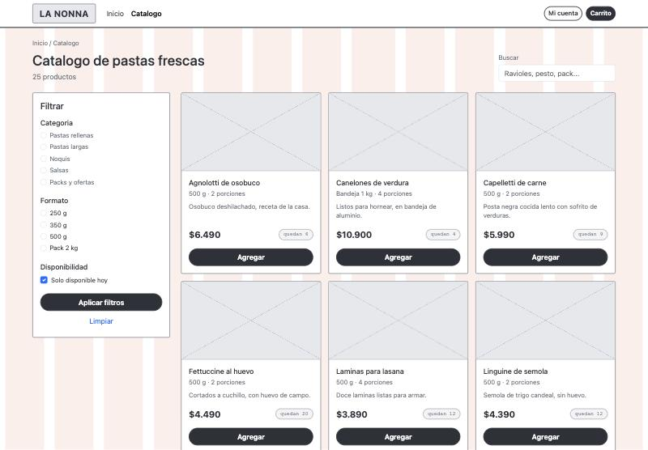

### Anexo 6 — Compra como invitado

Carrito con el campo de correo de contacto, validación de comuna contra el radio de
3 km, promoción de cuenta y el aviso de la regla de negocio del RF2.

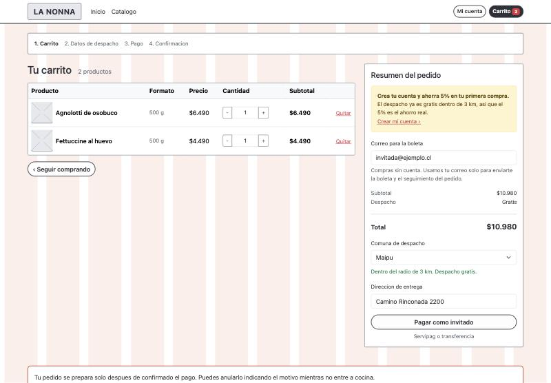

### Anexo 7 — Pedido creado con stock reservado

El pedido nace en `pendiente_pago` con la reserva de stock y su vencimiento. La
pantalla dice explícitamente que no puede declarar un pedido como pagado.

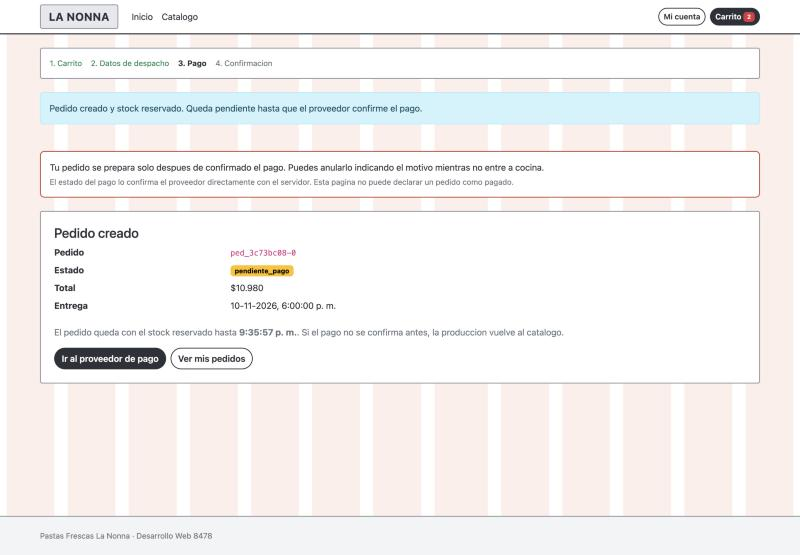

### Anexo 8 — Panel del dueño: segunda agregación GraphQL

Combina el modelo de lectura de `analytics` con la cola de despacho de `orders`.
El RUN aparece enmascarado y no hay sección "Mis pedidos", porque un dueño no es
comprador.


### Anexo 9 — Batería de pruebas automatizadas

**45 pruebas, 45 pasando, 0 fallos**, repartidas en flujo de compra, casos de
validación del Módulo 7, compra de invitado, promoción de primera compra y reporte
de ventas.

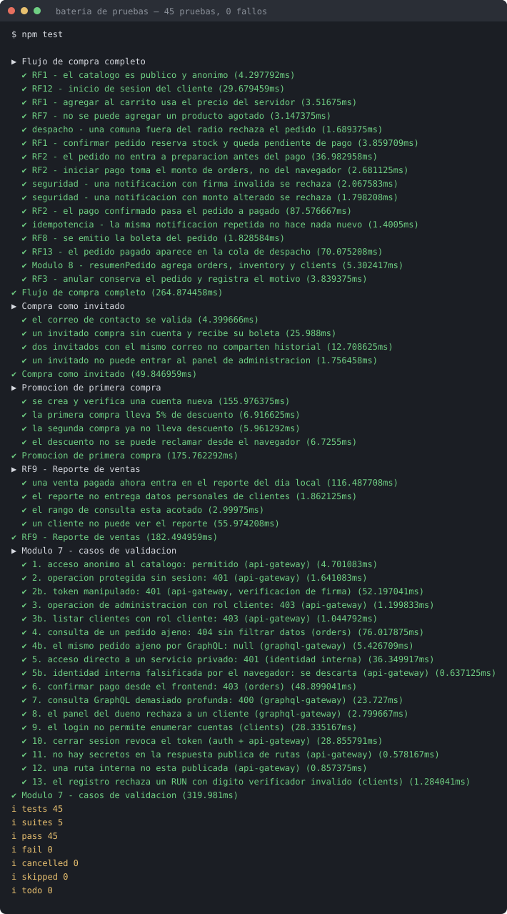

### Anexo 10 — Prueba de carga

Comparación de gRPC contra REST en la misma operación, capacidad del catálogo y
comportamiento del límite de solicitudes ante 255.394 peticiones desde una sola IP.


### Anexo 11 — Fronteras de red, lado a lado

El mismo recurso por el gateway y directo al puerto; una operación protegida sin
sesión; y una ruta interna desde fuera.

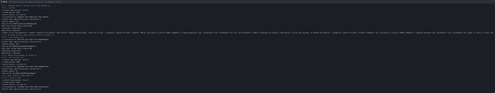

### Anexo 12 — Estructura del proyecto

Microservicios separados, los dos gateways, los contratos `.proto`, los scripts de
operación y la documentación. `data/` y `secrets/` existen pero están excluidos del
repositorio.

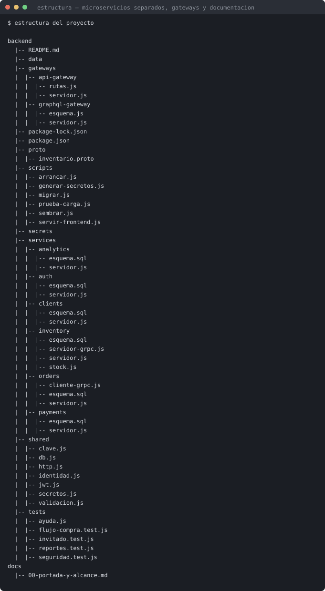

### Anexo 13 — Arranque del sistema

Los ocho procesos levantados, con su puerto y su visibilidad. Solo dos son
públicos.


### Formato de las imágenes

**Los cuatro diagramas son archivos `.drawio` nativos**, en `docs/diagramas/`. Se
abren y editan en [diagrams.net](https://app.diagrams.net), que es la herramienta
que usa el curso: la guía de evaluación cita `Microservicios.drawio` e
`Integracion.drawio` como material de apoyo. Los PNG que aparecen en este informe
los genera el visor oficial de diagrams.net, así que lo impreso y lo editable son
exactamente el mismo dibujo.

Para regenerarlos: `docs/herramientas/generar-drawio.py` arma los `.drawio` y
`render-drawio.py` los pasa a PNG a 2x con el visor oficial.

Las salidas de terminal están en SVG con copia PNG en `docs/png/`. Las capturas de
pantalla del navegador son JPG.

### Archivos de evidencia en bruto

Para quien quiera revisar la salida completa sin recortes:
`docs/evidencias/pruebas.txt`, `prueba-carga.txt`, `fronteras.txt` y
`rutas-y-secretos.json` (respuesta de `GET /api/v1/_rutas`, con las 33 rutas
publicadas, las 10 internas y las 4 referencias de secretos **sin valores**).
